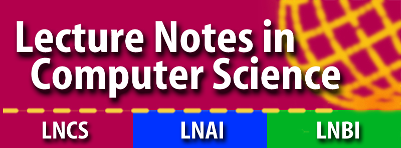

# DAIS 2027 - 27th International Conference on Distributed Applications and Interoperable Systems

DAIS 2027 is one of the three conferences of [DisCoTec 2027](.).

<!-- ### Quick Links
* [Submission Link](#submission) 
* [Proceedings](#proceedings)-->

# Scope
The DAIS conference series addresses all practical and conceptual aspects of distributed applications, including their design, modeling, implementation and operation, the supporting middleware, appropriate software engineering methodologies and tools, as well as experimental studies and applications. Submissions will be judged on their originality, significance, clarity, relevance, and technical correctness.

The topics of interest to the conference include, but are not limited to:

Novel and innovative distributed applications and systems, particularly in the areas of
* Cloud, edge and fog computing
* Data-center and internet-scale systems
* Middleware, micro-services, and service-oriented computing
* Big data, and complex event and stream processing
* Decentralised and distributed AI/ML (including TinyML & Federated Learning)
* IoT, cyber-physical, and mobile systems
* Peer-to-peer systems and distributed social networks
* Advanced networking

Novel architectures and mechanisms, particularly in the areas of
* Distributed storage and large-scale data management
* Consensus, blockchains, and smart contracts
* Publish/subscribe and epidemic protocols
* Virtualization, serverless computing and resource allocation
* Trusted execution environments

System properties and design goals
* Fault tolerance and dependability
* Scalability, elasticity, and tail performance
* Security, privacy, trust, and applied cryptography
* Interoperability, adaptation, and self-* properties
* Cooperation incentives, fairness, and energy efficiency

<!--
## DAIS Accepted Papers

### Regular papers

### Short papers
-->

## Submission and Publication

All papers must be original, unpublished, and not submitted for publication elsewhere. 
Each paper will undergo a thorough peer review by the Program Committee. 
DAIS 2026 offers three submission tracks:

* Research Papers (maximum of 15 pages + 2 pages references).
* Practical Experience & Industry Papers, including experimental and evaluation studies, and industrial case studies (maximum of 15 pages + 2 pages references).
* Short Papers, including work-in-progress papers, interim results (maximum of 6 pages + 2 pages references).
* Vision Papers, describing speculative but well-reasoned and thought-provoking ideas (maximum of 6 pages + 2 pages references).

Publication of proceedings is coordinated among the three DisCoTec conferences (see the [Conferences](conferences) page for details).

### Submission Link

<!-- TBA -->
Submissions are welcome via **[Easychair][DAIS27Submission]**. 
<!-- at: [https://easychair.org/conferences/?conf=dais27](https://easychair.org/conferences/?conf=dais27).-->

#### Important dates 

For papers of **all categories**:

- **Abstract submission:** 28 January 2027
- **Paper submission:** 04 February 2027
- Paper notification: 22 March 2027
- Camera-ready: 01 April 2027 (hard)
- Conference: June 14-18, 2027

Deadlines expire at 23:59 anywhere on earth on the dates displayed above.

### Proceedings

<!--TBA-->
<!-- The proceedings of DAIS 26 are published as Springer [LNCS Volume 16591](https://link.springer.com/book/10.1007/978-3-032-27358-1) -->

Publication of proceedings is coordinated among the three DisCoTec conferences (see the [Conferences](conferences) page for details). The DAIS proceedings will be published by Springer as an LNCS-IFIP volume and will comprise accepted submissions from __all__ categories.

## Program committee chairs
* [Vana Kalogeraki][VanaWeb] (Athens University of Economics and Business, Greece)
* [Francisco Maia][FranciscoWeb] (University of Porto, Portugal)

## Program committee

TBA

<!--## Artifact Evaluation Committee
TBC
-->

## Steering committee

* Daniel Balouek,	Inria, France
* Silvia Bonomi, Università degli Studi di Roma “La Sapienza”, Italy
* Lydia Y. Chen, University of Neuchâtel, Switzerland
* David Eyers, University of Otago, NZ
* Frank Eliassen,	University of Oslo, Norway
* Rüdiger Kapitza, Friedrich-Alexander-Universität Erlangen-Nürnberg, Germany
* Marta Patino-Martínez, Technical University of Madrid, Spain
* João Paulo, University of Minho, Portugal
* Jose Pereira, University of Minho / INESC TEC, Portugal
* Rolando Martins, University of Porto, Portugal
* Miguel Matos, University of Lisboa & INESC-ID, Portugal
* Ibéria Medeiros, University of Lisbon, Portugal
* Laura Ricci, University of Pisa, Italy
* Hans P. Reiser,	Reykjavik University, Iceland
* Anne Remke,	University of Münster, Germany
* Etienne Riviére, UCLouvain, Belgium
* Valerio Schiavoni (Chair)	University of Neuchâtel, Switzerland
* Mennan Selimi,	South East European University, North Macedonia
* Spyros Voulgaris, Athens University of Economics and Business, GR

[VanaWeb]: https://pages.cs.aueb.gr/~vana/
[FranciscoWeb]: https://fmaia.github.io/
[DAIS27Submission]: https://easychair.org/conferences/?conf=dais27 
